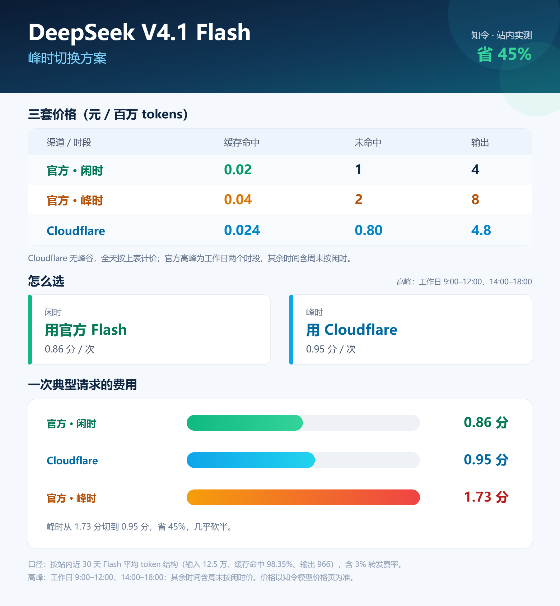

# DeepSeek 省钱组合：闲时用官方，峰时用 Cloudflare

> 同一件事，峰时 1.7 分，切一下 0.95 分。

DeepSeek V4.1 Flash 在知令有两个渠道：官方分峰谷，工作日高峰翻倍；Cloudflare 没有峰谷，全天一个价，整体只比官方闲时贵一点。

把两张价目表叠在一起看，答案很清楚：**闲时用官方，峰时用 Cloudflare**。

| 元 / 百万 tokens | 缓存命中 | 未命中 | 输出 |
|---|---:|---:|---:|
| 官方 · 闲时 | 0.02 | 1 | 4 |
| 官方 · 峰时 | 0.04 | 2 | 8 |
| Cloudflare | 0.024 | 0.80 | 4.8 |

峰时官方三项全部翻倍，Cloudflare 不动。切过去，缓存价降 40%，未命中降 60%，输出降 40%。

## 算一笔账

按站内近 30 天 34.8 万次调用的平均结构（12.5 万输入、98.35% 命中缓存、966 输出）：

- 官方闲时：**0.86 分**
- Cloudflare：**0.95 分**
- 官方峰时：**1.73 分**

峰时从 1.73 分切到 0.95 分，**省 45%**，几乎砍半。一天有一半时间在峰时的话，整体账单大约省三成。

## 为什么不一直用 Cloudflare

闲时官方更便宜：缓存 0.02 对 0.024，输出 4 对 4.8，便宜约 10%。

Cloudflare 的价值不是「绝对最低」，而是「没有峰时」——把最贵的那段时间，拉回接近闲时的水平。

## 怎么切

模型菜单里选名称带 Cloudflare 的那条 Flash（1017）。高峰是工作日 9:00–12:00、14:00–18:00，其余时间含周末按闲时（以模型价格页标注为准）。

## 一句总结

闲时用官方，峰时用 Cloudflare。按这个平均结构，任何时段一次对话都不超过 1 分钱。

想看看自己的实际账单，打开知令聊一句，展开输入框旁的指示器即可。官网：zhiling.plus

---

**参考信息**

- DeepSeek 官方模型与价格页：https://api-docs.deepseek.com/zh-cn/quick_start/pricing
- 知令模型价格页（含峰谷时段）：https://zhiling.plus/pricing/
- 知令官网：https://zhiling.plus/

[知令](https://zhiling.plus/)是一个开箱即用的全场景智能工作台：对话里可随时切换 DeepSeek、GPT、Claude、Kimi、MiMo 等模型，也能直接检索文献、解析 PDF、整理综述、导出文档。

#DeepSeek #AI工具 #知令 #降本增效

<!-- 备选标题：同样用 DeepSeek，峰时切一下，费用砍半 -->
<!-- 备选标题：DeepSeek 峰时省钱：官方管闲时，Cloudflare 管高峰 -->
