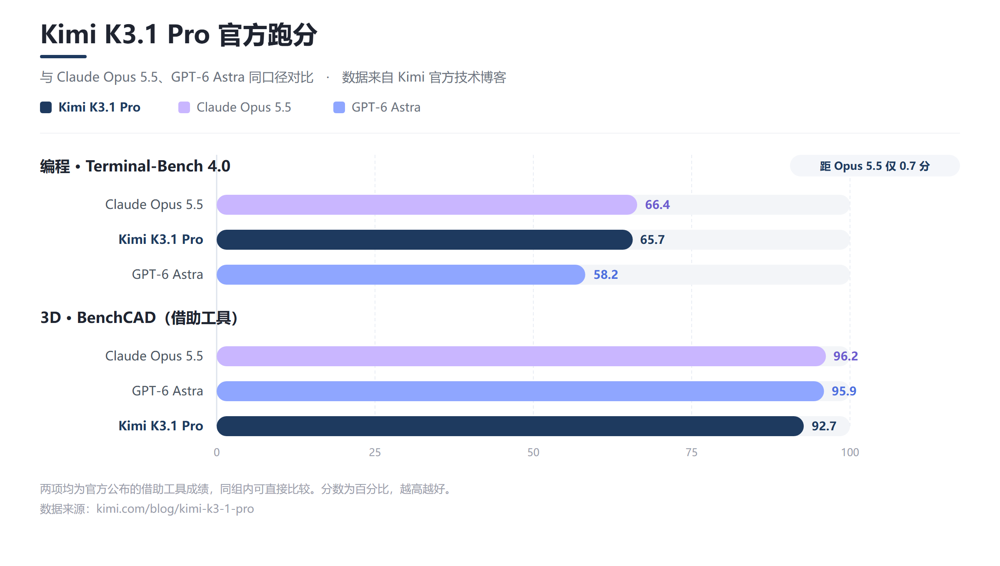

# Kimi K3.1 Pro 来了：编程只差 Opus 5.5 零点七分，知令已上线

10 月 24 日，1024 程序员节，月之暗面发布 **Kimi K3.1 Pro**。

它不是全新基座，而是站在 K3 上把后训练加码，尤其是强化学习。规格延续 3 万亿级参数、100 万 token 上下文，支持文本、图像和视频输入。

官方点名的提升方向是代码编程、3D 创作、金融研究和长程 Agent。

## 成绩单

编程基准 Terminal-Bench 4.0 拿到 **65.7%**，Claude Opus 5.5 是 66.4%，GPT-6 Astra 是 58.2%。差 0.7 分，已经在同一档。

3D 基准 BenchCAD 拿到 **92.7%**，同口径下 Opus 5.5 是 96.2%、Astra 是 95.9%。进了第一梯队，还没到顶。

还有一个不显眼但实用的变化：官方内部幻觉压力测试里，陈述级幻觉率从上代的 23.4% 降到 8.3%。这是专挑易错场景的测试，不代表日常错误率。

## 知令已上线

**Kimi K3.1 Pro 已在知令上线，开箱即用。**

打开知令，在模型列表里直接选用即可。

> 官网：zhiling.plus

---

**参考信息**

· Kimi 官方技术博客：https://www.kimi.com/blog/kimi-k3-1-pro

#大模型 #Kimi #月之暗面 #K3.1Pro #知令
