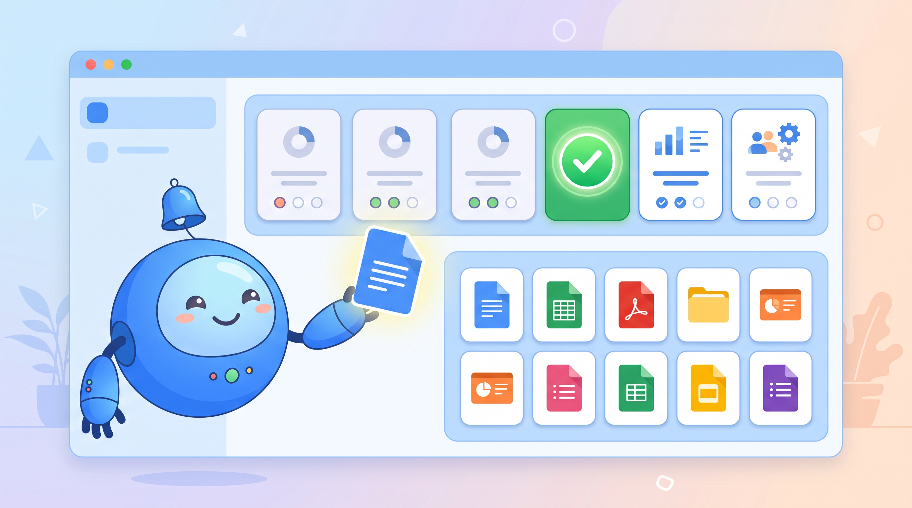

# 你好，司诏：知令全新智能体首次登场，一上来就是全能选手

## 备选标题

1. 《知令新成员报到：司诏首次亮相，能听、能看、还会干活》
2. 《一颗会干活的小圆球：司诏今天正式上岗》

---

喊一声「你好知令」，一个清亮的声音会应你——它是知令的新成员「司诏」，这次正式和大家见面。

别看它顶着「语音助手」的名号，它可不是"你问一句、它答一句"的那种。从第一次登场开始，司诏就是一个能听、能看、能干活的全能智能体。

听懂你的话，只是基本操作。它还能看懂你的屏幕、替你把活儿干完，最后把成果文件稳稳递到你手上。今天的主角，就是这颗小圆球。

## 一、不只会听，更会「看懂 + 做完」

提起语音助手，很多人的印象是"复读机升级版"：能听懂你的话，但活儿还得自己干。

司诏有自己的工作节奏。你说一句"帮我把这份材料整理一下"，它会自己拆步骤、找工具、动手做；遇到需要在工作区里干的重活儿，它还会干脆利落地交办出去，让工作区的会话接手，干完再把结果带回来向你汇报。

一句话交办，全程不用你盯。不是"听话"，而是"顶事儿"。

## 二、成果直接落到你手上

干活最爽的瞬间是什么？是看到成品的那一刻。这一步，司诏做得很实在。

文件交付区里，做完的文件整整齐齐排着队，图标和资源管理器同款，一眼认出是文档还是表格；双击一下，直接在内置的文件视图窗口里打开，PDF、表格、文档都能看，不打断你手头的节奏。

旁边的进度卡也在实时播报：排队、处理、执行、待回答、完成……每一单走到哪一步，瞄一眼就知道；右键还能一键跳回它干活的那个工作区。

像极了靠谱的助理：活儿干完了，文件放你桌角，还附一句"都在这儿了"。

## 三、它「记得你」

一个好助手，不该让你每次都从头解释。

司诏会"长记性"：它能感知你的工作环境，也存得下长期记忆——你的习惯、偏好、常用的工作区，它都会记住。聊过的话题自动归档，最近在忙什么它心里有数，下次开口，不用再交代前因后果。

会干活是本事，懂你才是默契。

## 四、好看好用，是一套的

颜值也是生产力。司诏带来了 6 款悬浮球形象，默认的「聆风铃」清清爽爽，还有经典云团和几款新造型随你换，桌面上的小助手也可以有自己的风格。

面板也很顺眼：任务区和交付区左右均分，滚动条轻轻浮在边缘不占地方；长对话自动分出轮次，最新一轮的消息稳稳"贴"在顶部，翻多久都不迷路。整体配色还和工作区主题保持一致，白天夜里都看着舒服。

## 五、桌面上的活儿，口袋里也能交

司诏不止住在电脑里。手机上的它，语音、文字两种输入形态随心切换：想说就说，说完接着聊，连续对话不用反复唤醒；不方便说话的时候，打字一样能交办任务。

更要紧的是，手机上交代的活儿，进度和成果会同步回桌面——通勤路上说一句，回到工位，文件已经躺在交付区里了。

---

现在就可以试试：喊一声「你好知令」，把话说完整一点，把活儿整个交给它。

它不是那种只会听你说话的语音助手，而是能听、能看、能干活、还能交出成果的智能体。

至于叫它「你好司诏」「你好小诏」还是「你好小令」……随你，它都答应。

<!-- 正文约1067字（含标点；纯中文字符约909，不含标点口径约911，均在800-1200字区间） -->
