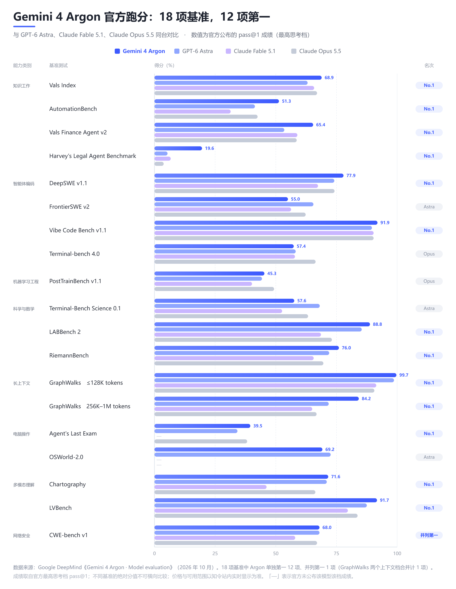
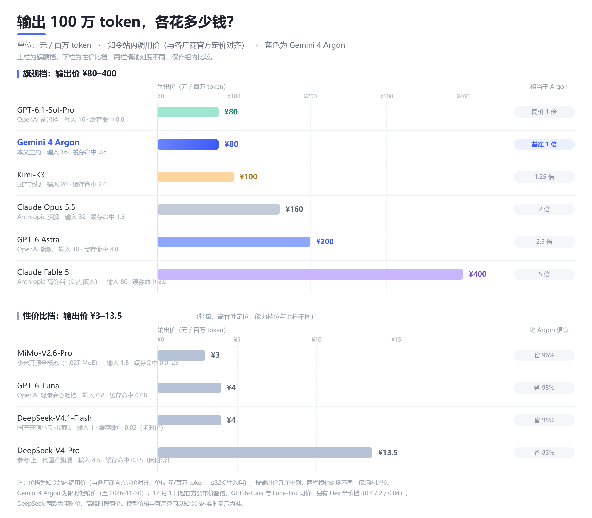

# 谷歌把压箱底的旗舰放出来了：Gemini 4 Argon 上线知令，100 万 token 一口气输出，价格还打五折

## 备选标题

1. 《Gemini 4 Argon 来了：18 项跑分 12 项第一，知令里现在就能用》
2. 《百万 token 输出的顶级旗舰，为什么现在是入手最划算的时候？》
3. 《Google 最强模型全球开放：$2 输入 / $10 输出，知令已直接接入》

---

先讲个细节。

过去一年，谷歌的大模型更新几乎都围着 Flash 系列转，旗舰 Gemini 3 之后，下一代迟迟不见影子。9 月 30 日，Gemini 4 系列的第一款旗舰 **Gemini 4 Argon** 终于发布——但它没直接卖给你我：第一批用户，是经过审查的网络安全防御团队。直到 10 月 14 日，它才真正对全球开放。

而这一次，你不用折腾：**知令已经把它接进来了，打开就能用。**

下面按「这模型到底强在哪 → 价格有多香 → 在知令里怎么用」三件事说清楚。

## 一、它强在哪：为「最难的活儿」而生

谷歌给 Argon 的定位很明确：不是陪你闲聊的，而是啃硬骨头的——真实世界的软件工程、企业知识工作（法律、金融、税务）、网络安全防御，这类**复杂、长链条**的任务。

三个硬指标值得记一下：

- **百万级上下文与输出。** 输入、思考、输出共享 1,048,576 tokens 的窗口。这里别误读：不是「百万输入 + 百万输出」，而是三者共用；同步请求默认最多输出 65,536 tokens，需要长输出时得开启 long decode。
- **原生多模态。** 文本、图片、音频、视频都能进，输出文本。一份长文档里混着表格、图表、截图，它也能一起读完再给结论。
- **可控的思考档位。** low / medium / high 三档，默认 medium；支持工具调用与结构化输出，适合接进智能体流程里真干活。

跑分上，官方放出的 18 项基准里，Argon 在 **12 项上拿了第一**。挑几个有代表性的：覆盖金融、编码、法律、税务的 Vals Index v2.1 排第一；Finance Agent v2 第一；IOI（Vals v2）拿到满分 100；Vibe Code Bench v1.1 达 91.90；长视频理解 LVBench 91.7%。

> 

说句公道话：**综合指数领先，不等于每个任务都第一**；而且官方的高分多在较高思考档下取得，默认 medium 档会略低一些。选模型，归根到底还是要看你的具体任务。

但方向是清楚的：在「长链条、要多步推理、还得动手」的活儿上，它是当前第一梯队的选手。

## 二、价格：这才是该划重点的地方

接下来的内容，建议截图存一下。

### 先看它自己的价

这一轮谷歌给的是**限时入门价**，到 **2026 年 11 月 30 日**结束；**12 月 1 日起直接翻倍**。

| 计费项 | 官方促销价（至 11/30） | 官方常规价（12/1 起） | 知令站内（人民币） |
| --- | --- | --- | --- |
| 输入 | $2 / 百万 token | $4 | ¥16 / 百万 token |
| 输出 | $10 / 百万 token | $20 | ¥80 / 百万 token |
| 缓存输入 | $0.1 / 百万 token | $0.2 | ¥0.8 / 百万 token |

翻译成人话：

- **输出一百万 token，80 块钱。** 一次让它输出十万 token 的长文或长代码，成本大约 8 元。
- **缓存命中只要 0.8 元，是输入价的二十分之一。** 那种「同一份长文档反复追问」的场景，几乎可以忽略不计。
- 一个提醒：**输出计费包含思考 token**，思考档越高越费。日常用 medium，硬任务再上 high，钱包会舒服很多。

### 再和市面上主流模型比一比

价格香不香，单看它自己不算数，得放进同档模型里比。下面是知令站内各主流模型的调用价（与各厂商官方定价对齐，单位：元 / 百万 token），按档位分成两组看。

**旗舰档**

| 模型 | 输入价 | 输出价 | 缓存命中价 | 一句话定位 |
| --- | ---: | ---: | ---: | --- |
| **Gemini 4 Argon** | **16** | **80** | **0.8** | 本文主角，官方 18 项基准 12 项第一 |
| GPT-6.1-Sol-Pro | 16 | 80 | 0.8 | OpenAI 前沿档，与 Argon 同价位 |
| Kimi-K3 | 20 | 100 | 2.0 | 国产旗舰，2.8T MoE 开源 |
| Claude Opus 5.5 | 32 | 160 | 1.6 | Anthropic 旗舰 |
| GPT-6 Astra | 40 | 200 | 4.0 | OpenAI 旗舰 |
| Claude Fable 5 | 80 | 400 | 8.0 | Anthropic 高价档 |

**性价比档**

| 模型 | 输入价 | 输出价 | 缓存命中价 | 一句话定位 |
| --- | ---: | ---: | ---: | --- |
| GPT-6-Luna | 0.8 | 4 | 0.08 | OpenAI 轻量高吞吐档（Pro 同价、Flex 半价） |
| DeepSeek-V4.1-Flash（闲时） | 1 | 4 | 0.02 | 国产开源小尺寸旗舰，1M 上下文；高峰翻倍 |
| MiMo-V2.6-Pro | 1.5 | 3 | 0.0125 | 小米开源全模态，1.02T MoE |
| DeepSeek-V4-Pro（闲时） | 4.5 | 13.5 | 0.15 | 上一代国产旗舰；高峰翻倍 |

> 

这两张表读成人话，是四句话：

- **旗舰档里，Argon 就是最便宜的那一档。** 输出一百万 token 花 80 元：比 GPT-6 Astra 省 60%、比 Claude Opus 5.5 省一半、比 Claude Fable 5 省八成；同价位只有 GPT-6.1-Sol-Pro（同样 16 / 80）。跑分上它们在同一档，价格却差出一倍到五倍。
- **缓存命中价 0.8 元，是旗舰档里最低的（与 Sol-Pro 并列）。** 对比 Astra 的 4 元、Opus 5.5 的 1.6 元、Fable 5 的 8 元：长对话、代码仓库、反复追问同一份长文档时，这个差距会被反复放大，往往比单次输出价更能决定总账单。
- **要说绝对便宜，还得往下看性价比档。** GPT-6-Luna 0.8 / 4、DeepSeek-V4.1-Flash 闲时 1 / 4、MiMo-V2.6-Pro 1.5 / 3——输出价只要 Argon 的二十分之一上下，缓存命中价低到 0.0125–0.08 元；DeepSeek-V4-Pro 闲时 4.5 / 13.5，也算一款便宜的上一代旗舰。
- **但它们和 Argon 不是一回事。** 这几款走的是轻量、高吞吐、高性价比路线（DeepSeek 两款还有峰谷时段差价），能力档位与 Argon 不同。Argon 的卖点是「顶配能力里最便宜的那个」，而不是「最便宜的那个」。

> 名称与口径说明：价格表用的是知令站内名称；跑分图沿用谷歌官方对比中的名称（官方的 Claude Fable 5.1，在站内叫 Claude Fable 5）。GPT-6-Luna 与 Luna-Pro 同价，站内另有 Flex 半价档（0.4 / 2 / 0.04）；DeepSeek 两款为闲时价，高峰时段翻倍。

最后两点提醒：**折扣是有期限的**，促销 11 月 30 日结束，之后官方公布价翻倍；**价格跟着官方走**，站内价与各厂商官方定价对齐，实际以页面实时显示为准。

## 三、在知令里怎么用：三步，不用折腾

先说一句知令是什么：一个把模型、文件、代码、远程机器和计算任务都装进同一个窗口的 **AI 智能体工作台**，桌面端 + 移动端，注册即用。

想用上 Gemini 4 Argon，走官方流程是：注册谷歌账号、绑国际信用卡、申请 API Key、处理网络问题、按美元计费……每一步都能劝退一批人。

在知令里，这些都不用：

1. 打开知令，在模型列表里就能看到 **Gemini-4-Argon(google-vertex/global)**；
2. 选中它，像用其它模型一样，直接开始；
3. 桌面端、移动端都能用，人民币计费、中文界面。

再补几件配套的事：

- **数据安全。** 这一条走的是 Google Vertex 全球区标准档，知令里带「数据安全」标记（绿盾），私密内容处理更安心。
- **百万上下文配上工作区，才叫物尽其用。** 把长文档、表格、代码仓库丢进工作区，让它连着读、连着干——这才是百万窗口该有的打开方式。
- **新用户福利。** 注册即得 ¥10 体验金，全模型通用，可以直接拿来试它。

## 写在最后

Gemini 4 Argon 是一次「迟到的旗舰更新」：谷歌攒了很久，先把它交给最难的那类任务，再放开给所有人。

而现在正好是个窗口期——**官方折扣到 11 月 30 日截止，之后价格翻倍**。想试前沿模型、手里又真有硬任务要啃的话，没有比这更合适的时机了。

知令里，已经可以直接选它。

> 说明：模型价格与可用范围以站内实时显示为准；本文数据来自 Google 官方发布与公开评测整理，核实时间 2026 年 10 月。

**知令 · 让 AI 干活，让 Token 自由**
