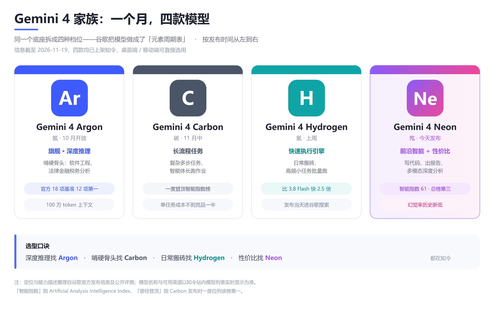
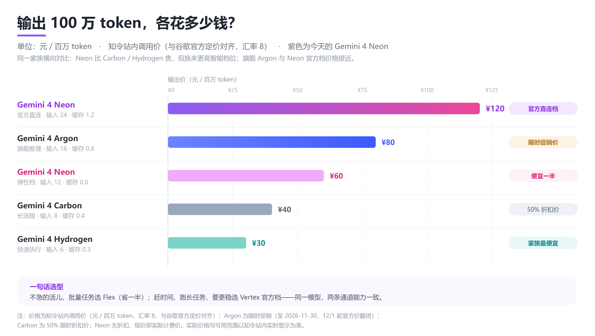

# 一个月四连发！谷歌把模型做成了「元素周期表」

## 备选标题

1. 《Gemini 4 Neon 发布：比 Carbon 快、比 Hydrogen 聪明，知令已全家族上架》
2. 《谷歌一个月发了四款模型：AI 开始「按档位」卖了》
3. 《Gemini 4 全家族上架知令：从旗舰到性价比，一文选对模型》

---

今天，谷歌发布 **Gemini 4 Neon**——这是它**一个月内的第四款** Gemini 4 系列模型。

隔壁 OpenAI 的下一代旗舰还在路上，谷歌已经快把一整张「元素周期表」发完了。

> 

## 碳、氢、氖、氩：四款模型，四种活法

一个多月前，旗舰 **Argon（氩）** 打头阵，主攻深度推理；接着 **Carbon（碳）** 专啃复杂长流程，一度登顶智能指数榜；上周 **Hydrogen（氢）** 定位「快速执行引擎」，发布当天就进了谷歌搜索；今天轮到 **Neon（氖）**——比 Carbon 快、比 Hydrogen 聪明，主打「前沿智能 + 性价比」。

> 

翻译成人话：**深度推理找 Argon，啃硬骨头找 Carbon，日常搬砖找 Hydrogen，要性价比找 Neon。**

## 今天的主角，强在哪

- 智能指数 **61 分、总榜第三**，只输给两款更大、更慢的模型；
- Vals Index **第二**，卡在「帕累托前沿」——性能和成本的平衡点上，暂时没有对手；
- **幻觉率历史新低**，Agent Arena 可操控性第二，任务中途改需求也能接住；
- 100 万 token 上下文，PDF、表格、图表、音视频直接丢进去；
- 还能当「包工头」：在 Antigravity 里调度多个 Hydrogen 子智能体并行干活。

一句话：**能干活，也能带团队。**

## 价格：家族里的「甜点位」

> 

- Flex 弹性档 **12 / 60 元**（输入 / 输出，每百万 tokens），官方直连档 **24 / 120 元**；
- 不急的活儿、批量任务走 Flex，价格直接腰斩；赶时间、跑长任务再切官方档；
- 缓存命中只要 **0.6 元起**，同一份长文档反复追问，几乎可以忽略不计。

## 怎么用：知令已全量上架，开箱可用

先给结论：**Gemini 4 全家族（Argon / Carbon / Hydrogen / Neon），知令已经全部上架，开箱可用。**

不用申请内测、不用自备 API Key、不用折腾网络、不用升级客户端——模型列表由站端下发，桌面端、移动端同一份，打开就是最新的。

三步上手：

1. 打开知令，进入任意会话；
2. 点输入框底栏左侧的模型名（或按 **Ctrl+M** 切换），在 **Google** 分组里选 `Gemini-4-Neon`；
3. 直接开聊。需要更深的推理，把思考档位调到「高」或「最高」。

菜单里你会看到两条 Neon：

- `Gemini-4-Neon(google-ai-studio/flex)`——**便宜**：12 / 60 元；
- `Gemini-4-Neon(google-vertex/global)`——**更稳**：24 / 120 元。

最后一句提醒：**别用大炮打蚊子**。写代码、出报告、做多模态分析用 Neon；高频小任务切 Hydrogen；真啃硬骨头再上 Carbon / Argon。

## 写在最后

从「比模型」到「比矩阵」，谷歌这波已经把压力给到对手，红利留给用户：模型越来越快、越来越便宜、越来越多。

下一款「元素」发出来，知令这边也会第一时间跟上——**你只管挑模型，剩下的适配交给我们。**

> 说明：模型价格与可用范围以知令站内实时显示为准；本文数据整理自谷歌官方发布与公开评测，核实时间 2026 年 11 月。

**知令 · 让 AI 干活，让 Token 自由**
