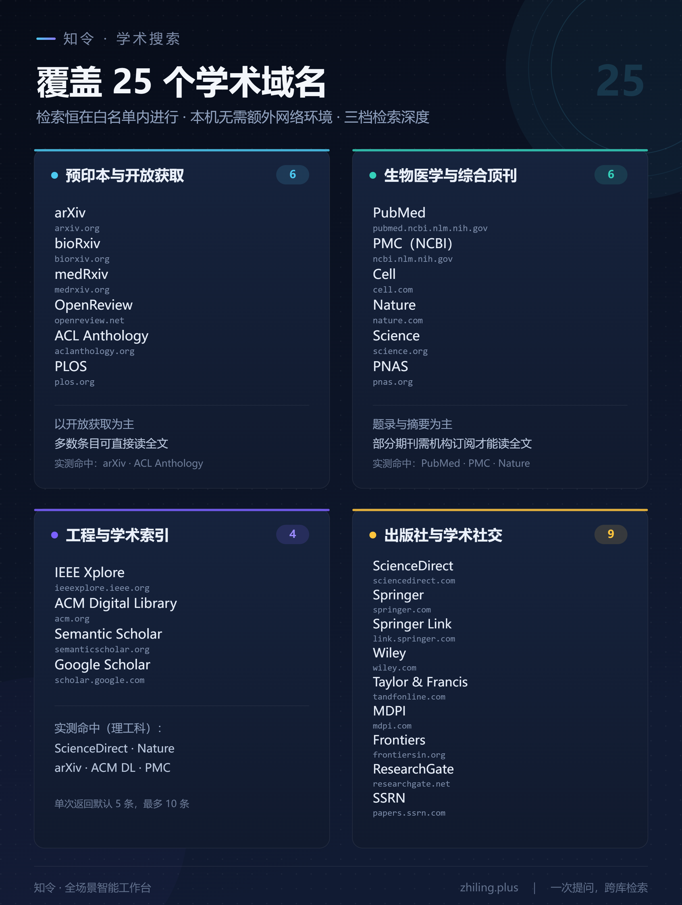

# 知令学术搜索：不用翻墙，也能查文献

> 25 个学术域名，检索在云端完成。

做研究的第一关，往往不是读不懂，而是打不开。

Google Scholar 转圈，PubMed 时好时坏，IEEE Xplore、ScienceDirect 点进去先要机构权限。很多人第一次意识到「要翻墙」，就是在找文献的时候。

## 把检索挪到云上

知令的学术搜索，把检索这一步放在服务侧完成：请求由服务侧发出，本机不需要额外网络环境，也不用另配线路，打开就能搜。结果直接回到会话里：标题、域名、摘要和 AI 综述都能就地读完。要读全文再点标题跳转，能否打开取决于站点本身——PMC、arXiv、ACL Anthology、MDPI 这类开放获取最稳，付费墙期刊仍需机构权限。

范围是固定的：内置 25 个学术域名白名单，检索恒在这个集合内进行，不漫游全网。从 arXiv、bioRxiv 这类预印本，到 PubMed、Nature、Science、Cell 这些生物医学与综合顶刊，再到 IEEE Xplore、ACM DL、ScienceDirect、Springer 等工程与出版社站点，四组共 25 个，完整清单见图。

## 能搜到什么

我们做了 4 次实测，全部成功；3 次完整计时落在 21.5–24.1 秒。

搜「GLP-1 receptor agonists cardiovascular outcomes meta-analysis」（deep 档），5 条结果里 4 条直接是 PubMed 的文献页，剩下 1 条来自 ScienceDirect。

人文社科也不是荒漠。搜「digital humanities text mining methodology」，命中 ACL Anthology 的 NLP4DH 论文 PDF、Springer 的方法论专著、MDPI 的开放获取论文。

4 次检索一共落在 9 个学术域名上：PubMed、PMC、ScienceDirect、Nature、Springer、arXiv、ACL Anthology、MDPI、ACM DL。

## 不只是链接

结果是一张结构化卡片：序号、可点开原文的标题、域名徽章、可展开的摘要。文献条目上方还有「AI 综合摘要」入口，点开是一篇带「域名 + 链接」行内引注的综述，一段里常挂两三条来源，省掉第一轮粗读。

中文提问同样能用。输入「大语言模型在科研写作中的应用 综述」，返回 5 条英文文献（ACM、PMC、arXiv、Springer），摘要整段是中文，还带「一、核心应用场景」这类小标题。中文提问、外文文献、中文交付。

## 怎么用

打开知令，新建会话，直接说「用学术搜索查一下 XXX」；或者切到「科研」模式。检索深度分三档：快速（quick）、标准（standard，默认）、深度（deep，覆盖更全、费用更高）。单次默认返回 5 条，最多 10 条；4 次实测单次花费 ¥0.056–0.087，一次不到一毛钱。

搜到之后，还能接着让知令把 PDF 高质量解析成可读文本、按「撰写文献综述」技能整理成综述、再导出 Word——从检索到成稿，都在一个会话里完成。

## 一句边界

检索到的是公开可访问的文献线索——题录、摘要、开放获取全文。AI 摘要是模型综合生成，引用其中具体数据前，请回原文核对。

如果你也受够了在文献门口反复找线路，欢迎来试一次。官网：zhiling.plus

---

**参考信息**

- GLP-1 受体激动剂心血管结局 meta 分析（实测命中文献）：https://pubmed.ncbi.nlm.nih.gov/34425083/
- NLP4DH 论文 PDF（实测命中）：https://aclanthology.org/2024.nlp4dh-1.10.pdf
- 知令官网：https://zhiling.plus/

[知令](https://zhiling.plus/)是一个开箱即用的全场景智能工作台：对话里可随时切换 DeepSeek、GPT、Claude、Kimi、MiMo 等模型，也能直接检索文献、解析 PDF、整理综述、导出文档。

#学术搜索 #文献检索 #知令 #科研工具 #研究生

<!-- 备选标题：找文献卡在打不开的页面上？知令学术搜索覆盖 25 个学术域名 -->
<!-- 备选标题：不用另配线路：知令学术搜索实测，4 次检索命中 9 个学术域名 -->
