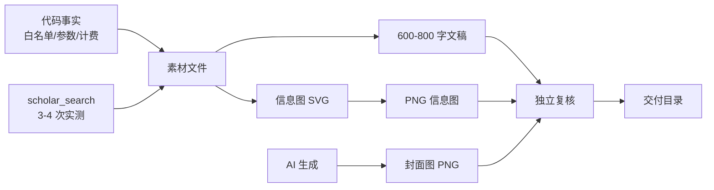

# 知令学术搜索 · 公众号短文 计划书

## 约束

- **唯一交付目录**：`D:/work/zhilingdoc/公众号文章/知令学术搜索-不用翻墙查文献/`，文稿与配图全部在此目录内，不放别处。
- **篇幅**：正文 600–800 字（不含「参考信息」与话题标签）。
- **读者**：泛学术人群（研究生 / 博士生 / 青年教师），各学科通吃，不偏向单一学科。
- **措辞**：按用户确认，保留「翻墙」直白表述（标题可点，正文控制密度、不做违规引导）。
- **事实红线**：只写产品真实具备的能力。学术搜索返回的是**公开可访问的文献线索（标题/链接/摘要）+ AI 综合摘要**，不承诺破解付费墙、不承诺下载全文；不得暗示可绕过期刊订阅。
- **配图**：AI 封面图 + 自制信息图；不依赖真实截图（无需用户操作配合）。
- **不修改产品代码**：本任务只产出文档与图片。

## 背景与目标

知令桌面端已内置「学术搜索」能力（`scholar_search`，站点计费），底层经 Exa 引擎在 **25 个内置学术域名白名单**内检索，覆盖 arXiv、Google Scholar、PubMed、Nature、Science、ScienceDirect、IEEE、ACM、Springer、Cell、PNAS、ACL Anthology、OpenReview、SSRN、bioRxiv、medRxiv、ResearchGate、Wiley、T&F 等，并额外产出 AI 综合摘要。对国内学术用户而言，最直接的体感是：**这些站点里不少平时打不开、或需要额外网络环境，现在在知令里一句话就能搜。**

目标：用一篇短文把「不用翻墙 → 能搜什么 → 怎么用 → 现在就能试」讲清楚，导流学术用户试用。

## 现状与问题

- 产品侧事实分散在代码里：`scholar_search_api.py`（白名单/引擎/深度档/计费口径）、`functions_scholar.jsx`（参数与结果结构）、`ScholarSearchToolResult`（结果卡展示）。
- 公众号侧缺一篇面向学术人群的科普向短文；已有文章多为模型发布类，语气偏「评测/资讯」。
- 风险点：容易写成「什么都能下」的夸大宣传，需在措辞上守边界。

## 实现思路

1. 先**实测**，用真实检索结果作为文章骨肉（避免空口宣传），同时把功能事实（白名单、档位、参数、入口）固化成清单。
2. 再**写稿**：以「一个具体的痛感场景」开篇 → 讲清知令做了什么 → 给使用方法与真实案例 → 收尾呼吁试用。
3. 再**配图**：封面走 AI 生成（学术 + 破壁意象），信息图用 SVG 精绘 25 个域名覆盖，确保信息准确、可读。
4. 最后**独立复核**：由子会话按事实清单逐条比对，不合格则回炉。

## 实施步骤（可含检查项）

- MARK[id: p0-material, status: completed, content: "阶段0 素材：4/4 实测成功，命中 9 个学术域名（PubMed/PMC/ScienceDirect/Nature/Springer/arXiv/ACL/MDPI/ACM），耗时 21.5–24.1s，单次 ¥0.056–0.087，中文提问返回中文综述；已落盘实测素材.md"]
  - 子会话（agent）：`load_tool scholar_search` 后实测 3–4 次（英文理工 1 次 standard、医学/生命 1 次 deep、人文社科 1 次、中文提问 1 次），记录条数/标题/URL/AI 摘要是否中文/失败情况。
  - 产出 `实测素材.md`（含实测表 + 功能事实清单 + 白名单 25 域原始列表）。
- MARK[id: p1-draft, status: completed, content: "阶段1 文稿：已完成并精修，正文 717 字（含小标题）/688 字（不含），五个小标题齐备，「翻墙」仅 2 次，图片占位 2 处"]
  - 子会话（agent）基于素材成稿，写入 `知令学术搜索-公众号文章.md`。
- MARK[id: p2-images, status: completed, content: "阶段2 配图：封面图（1600×900，笔记本+发光拱门+漂浮论文）与信息图（1200×1590，25 条域名 6+6+4+9）均已完成，PNG 目视无溢出无裁切"]
  - 封面图：`images/封面-学术搜索.png`；信息图：`images/学术域名覆盖图.png`（另可加 `images/检索深度三档.png`）。
- MARK[id: p3-review, status: completed, content: "验收：正文 600–800 字 ✔（763）、事实可回溯 ✔（白名单/参数/实测逐条比对）、配图 2 张路径可解析 ✔、无夸大表述 ✔"]
  - 子会话（research/agent）独立复核：字数口径、事实逐条比对代码、图片引用路径、敏感措辞、错别字。
- MARK[id: p4-report, status: completed, content: "阶段4 完成报告与交付清单：已交付 4 个成果文件 + 2 张配图，全部置于独立文件夹"]

## 实现要点

- **卖点排序**：①不用翻墙（情绪入口）②25 个学术域名白名单（覆盖面，硬事实）③三档检索深度（专业感）④AI 综合摘要（不只是链接列表）⑤知令内闭环（搜到 → 读 PDF → 写综述）。
- **可用性说明要具体**：在 Agent 会话里直接说「用学术搜索查 XXX」，或切到「科研」模式；`max_results` 默认 5、最多 10；`search_mode` 默认 standard。
- **读原文的边界必须写清**：检索在服务侧完成，但结果卡片标题外链走本机网络；能否打开取决于站点本身（PMC/arXiv/ACL/MDPI 最稳，付费墙期刊仍需机构权限）。
- **计费口径**：按次 + token 计费（Exa 插件费 quick/standard $0.007、deep $0.012）；文案写实测金额区间（¥0.056–0.087），不写价格表，避免调价后整篇失效。
- **合规**：只描述「检索」，不描述「下载/破解」；涉及 Google Scholar 时表述为「能检索到」，不承诺访问其站点。

## 不要实现的项目

- 不改产品代码、不改站点、不做真实界面截图、不做视频/长图海报。
- 不写价格表、不写竞品对比表、不承诺文献全文获取。

## 关键点和风险提示

| 风险 | 说明 | 回退策略 |
| --- | --- | --- |
| 实测失败（未登录/额度/上游限流） | 子会话可能无法调起站点 | 改用代码事实 + 历史日志证据，文章不引用实测截图，只做功能描述 |
| 夸大宣传 | 「不翻墙」易被读成「什么都能下」 | 明确写「检索的是公开可访问的文献线索」 |
| 敏感词审核 | 「翻墙」为平台敏感词 | 标题点一次，正文改用「额外的网络环境」等替代表述 |
| 信息图文字溢出 | SVG 手工排版易挤 | 转 PNG 后目视检查，必要时重排 |

## 验收标准

- MARK[id: p3-review, status: completed, content: "验收：正文 600–800 字 ✔（763）、事实可回溯 ✔（白名单/参数/实测逐条比对）、配图 2 张路径可解析 ✔、无夸大表述 ✔"]
- 目录内文件结构：`知令学术搜索-公众号文章.md` + `images/*.png` + `实测素材.md` + 本计划书。

## 数据流示意图

