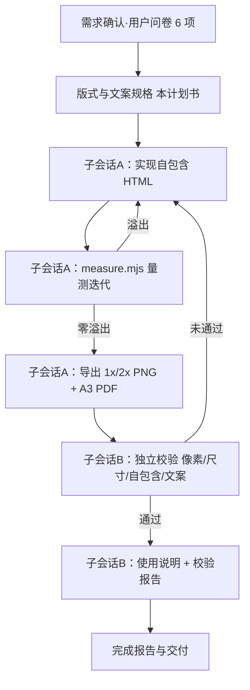
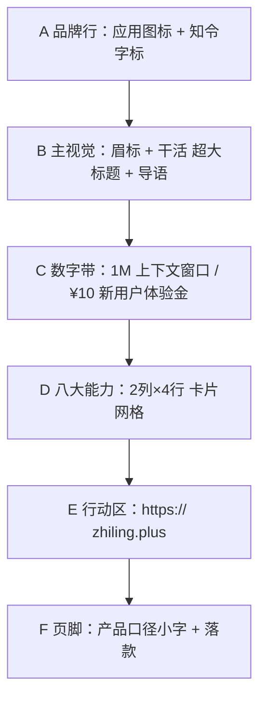

# 知令产品介绍 · 竖版海报（复刻校园海报风格）

## 约束

1. **风格对齐**：完全沿用 `D:/work/zhilingdoc/知令合伙人计划-校园海报/知令合伙人计划-校园海报.html`（v5 定稿）的视觉语言与工程约定——白底、9:16 双画布自适应（`1rem = min(100vw/1080, 100vh/1920)`）、rem 计量、内联 SVG、**单文件自包含**（无任何外链/网络资源）。
2. **交付形态（用户已确认）**：竖版 1080×1920；同款三件套 = 单文件 HTML + 1080×1920 PNG + 2160×3840 PNG + A3 竖版单页 PDF。
3. **二维码白名单（v4 起修订本条）**：行动区允许且**仅允许**呈现**官网二维码**（内容严格为 `https://zhiling.plus`，内联 SVG）+ 官网锁排（`https://` 小字 + 主域名大字 + 渐变短线）；**不得出现**社交码 / 邀请码 / 群二维码 / 合伙人相关二维码。
4. **福利口径**：只保留「注册即得 ¥10 体验金」，**不得出现** ¥30 Token 券、邀请返佣、分红、提现等合伙人相关内容。
5. **不提 Hermes 具体名**：科研能力按「科研场景深度适配」的口径写（学术搜索 / 论文解读 / 文献综述 / 科研写作），不出现 Hermes / Nous Research 等外部产品名。
6. **文案原创性**：不得把用户给的要点原句直接罗列（不要「最适配科研工作的 Hermes，学术搜索，科研论文解读等等支持」这类生硬句子），需改写为海报化短句。
7. **不改动主项目**：`D:/work/zhiling` 与既有校园海报目录一律只读；新物料只落在 `D:/work/zhilingdoc/知令产品介绍-海报/`。
8. **主题适配说明**：本物料为**打印/投屏导向的浅色海报**，按 v5 口径只做浅色版（不产出深色变体）；此点已在规格中固化，不视为违反「界面组件需深浅色适配」约定（非 App 组件）。

## 背景与目标

校园海报（v5 定稿）已在校园场景验证：超大标题 + 大色块 + 强对比信息的版式有很好的远读识别度。
本次目标是把同一套视觉语言搬到**产品介绍**场景：面向潜在客户/合作伙伴，一屏之内讲清「知令是什么、强在哪、马上怎么用」。

目标交付物：`D:/work/zhilingdoc/知令产品介绍-海报/`

| 文件 | 说明 |
| --- | --- |
| `知令产品介绍-海报.html` | 源文件（单文件自包含，改文案只改这里） |
| `知令产品介绍-海报-1080x1920.png` | 电子版（1x） |
| `知令产品介绍-海报-2160x3840.png` | 高清版（2x） |
| `知令产品介绍-海报-A3.pdf` | A3 竖版单页打印版 |
| `_scripts/export_poster.ps1` | 一键导出脚本（改路径指向本目录） |
| `使用说明.md` | 交付说明（改文案/换色/重导出/校验方法） |

## 现状与问题

- v5 的结构是「品牌行 → 主视觉 → 数字带 → 底部两栏（三步 + 网址/二维码）→ 页脚」；产品介绍需要**替换中后段**：把「三步加入 + 二维码」换成**八大能力网格 + 纯网址行动区**。
- 内容量比 v5 大得多（8 个能力模块），1920 高内要同时容纳超大标题与 8 卡片，**溢出是首要风险**；必须复用 v5 的量测手段做像素级收敛。
- v5 的合规小字（年满 18 周岁、以平台结算为准）属合伙人语境，产品介绍需替换产品口径小字。

## 实现思路

**版式蓝图（自上而下，6 段）**

```
A 品牌行     知令应用图标（蓝圆内联 SVG）+「知令」官方字标（内联 SVG，着色=--blue）
B 主视觉     眉标「知令 · 全场景智能工作台」+ 左侧渐变竖条 + 两字超大标题「干活」（干=近黑 / 活=品牌蓝渐变）
             下方一行导语（muted）点明场景
C 数字带     浅蓝底双大数字带：1M（上下文窗口） | ¥10（新用户体验金）+ 底部合规脚注
D 八能力     kicker「八大能力」+ 2 列 × 4 行卡片网格（图标 + 标题 + 一句描述）
E 行动区     左右等分对称（1fr 1fr）：左＝网址锁排 https:// zhiling.plus + 渐变短线 + 说明；右＝官网二维码卡 + 说明；中轴一条渐变竖线；两侧说明同行同高
F 页脚       贴底靠右：两行产品口径小字 + 落款「知令 · 让 AI 干活，让 Token 自由」
```

**色板（与 v5 完全一致，保证同款气质）**

```css
--blue:#545BFC; --blue2:#7C6FF7; --grad:linear-gradient(135deg,#545BFC,#7C6FF7);
--ink:#0E1024; --ink2:#626A80; --muted:#656C82; --line:#E4E6F8; --line2:#D8DCF2;
.poster{padding:92rem 92rem 68rem; background:#FFFFFF;}
```
装饰层沿用 v5 的两处淡色几何（右上大圆 + 外环 / 左下圆角方），比例按新页面高度微调。

**文案规格（定稿，不得生硬堆砌用户原句）**

| 位置 | 文案 |
| --- | --- |
| 眉标 | `知令 · 开箱即用的全场景智能工作台` |
| 主标题 | `干活`（t1「干」近黑实色 / t2「活」品牌蓝渐变字；起始 220rem，**定稿 200rem**） |
| 导语 | `科研 · 工程 · 办公 · 创作，一句话交给 AI 去干` |
| 数字带左 | `1M` + 单位 `token` ｜ 标签 `百万级上下文` ｜ 说明 `长文与长任务，一次读完` |
| 数字带右 | `¥10` ｜ 标签 `新用户福利` ｜ 说明 `注册即得体验金，全模型通用` |
| 数字带脚注 | `※ 模型清单、能力范围与活动规则以站内实时显示为准` |
| 能力区 kicker | `八大能力` |
| 卡片 1 | `科研工作` — `学术搜索 · 论文解读 · 文献综述与写作` |
| 卡片 2 | `世界顶级模型` — `GPT-6 Astra Pro、Claude Fable 5 等，不掺水、不降智` |
| 卡片 3 | `日常高频` — `DeepSeek-V4.1-Flash 深度适配，快而稳` |
| 卡片 4 | `图像与视频` — `Nano Banana Pro 生图 · Veo 3.1 生视频，本地剪辑与转码` |
| 卡片 5 | `Office 文档` — `Word / Excel / PPT 直接读写与编辑` |
| 卡片 6 | `工程与计算` — `本地与远程项目、终端、SLURM 计算任务` |
| 卡片 7 | `多端协同` — `桌面端 · 移动端 · 语音助手「司诏」` |
| 卡片 8 | `数据安全` — `可选高安全等级上游，私密数据安心处理` |
| 行动区·左 | 锁排 `https://`（26rem 蓝）+ `zhiling.plus`（54rem 近黑 900）+ 渐变短线；说明 `注册即用，多端通用`（v5 由「桌面端 · 移动端 · 语音助手，注册即用」改定，理由见使用说明 v5 行） |
| 行动区·右 | 官网二维码卡（内联 SVG，`https://zhiling.plus`）+ 说明 `扫码访问知令官网` |
| 页脚 | `· 模型价格与可用范围以站内实时显示为准` ／ `· ¥10 体验金为新用户注册福利，规则以站内公示为准` ／ 落款 `知令 · 让 AI 干活，让 Token 自由` |

**事实口径（已核实，来源可追溯）**

- `1M 上下文`：GPT-6 Astra 105 万 token、Claude Fable 5 与 DeepSeek-V4.1-Flash 均为 1M 上下文（来源：知令模型库 `modelinfo` 条目与站内模型介绍页）。
- `¥10 体验金`：知令新用户注册福利（来源：`D:/work/zhilingdoc/.md-cache/知令软件介绍页.pptx.md`）。
- 卡片 2 的模型名（GPT-6 Astra / Claude Fable 5）为当前**桌面端可见**模型（来源：开发站模型库导出 `modelinfo_export_20261012_083604.json`，`desktop_visible` 列表）。
- 卡片 6 的 SLURM/终端、卡片 5 的 Office 编辑、卡片 4 的视频本地剪辑，均为知令已具备能力（来源：`D:/work/zhilingdoc/intro.md` 第六/七节与本次会话已加载的工具集）。

**卡片图标**：8 枚内联 SVG 线形图标（统一 2–3rem 蓝色描边、圆角端点），主题分别为：放大镜+文档（科研）、指北星（顶级模型）、闪电（性价比）、图片/播放（图像视频）、文档页（Office）、终端 `>_`（工程计算）、三端设备（多端协同）、盾牌（数据安全）。**全部内联，禁止外链图标库**。

## 实施步骤（可含检查项）

- MARK[id:p1, status:completed, content: 阶段一·需求确认与版式文案规格（用户问卷已确认 6 项口径）]
- MARK[id: s1, status: completed, content: "子会话 A｜建目录骨架 + 实现自包含 HTML（六段结构、色板、内联 SVG 图标与字标、A3 打印规则）"]
- MARK[id: s2, status: completed, content: "子会话 A｜拷贝并改造 measure.mjs，量测迭代至 contentBottom ≤ contentLimit（无纵向溢出、无横向滚动）"]
- MARK[id: s3, status: completed, content: "子会话 A｜拷贝并改造 export_poster.ps1，导出 1x/2x PNG + A3 PDF 到交付目录"]
- MARK[id: s4, status: completed, content: "子会话 B｜独立校验：尺寸/自包含/二维码0/禁用词0/像素抽样/事实口径/母项目零改动——全部实测通过"]
- MARK[id: s5, status: completed, content: "子会话 B｜使用说明.md（16.6KB，七节）+ _draft/校验报告.md + 对比图——已产出"]
- MARK[id: s6, status: completed, content: "子会话 A2｜精修轮：CJK keep-all 消除拆词、八卡描述单行化、主标题 168→200rem、底部留白 9→38rem、眉标补『开箱即用』、重导出"]
- MARK[id: p6, status: completed, content: "阶段六·交付使用说明与完成报告"]
- MARK[id: r1, status: completed, content: "修订轮 A｜卡片4「图像与视频」改为「Nano Banana Pro 生图 · Veo 3.1 生视频，本地剪辑与转码」；行动区改横向两栏（左网址锁排 / 右二维码卡 254rem、码面 220rem）；全篇压缩收敛；三件套重导出"]
- MARK[id: r2, status: completed, content: "修订轮 B｜独立校验 A–I 全项通过（二维码四路解码严格 = https://zhiling.plus；与实现者自述 0 处不一致）；已更新 _draft/校验报告.md（+291 行）、verify_extra.py、使用说明.md（207→229 行）"]
- MARK[id: r3, status: completed, content: "修订轮 C（v5）｜行动区版式优化：左右等分镜像（1fr 1fr）+ 画布中轴 2rem 渐变竖线 + 左侧 .url 定高 254rem 垂直居中（与二维码卡上下沿对齐）+ 两侧说明统一 24rem/700/--ink2 + 左侧说明改「注册即用，多端通用」+ 八能力→行动区间距 32→36rem；复测 overflow=0、actionToFooter=22、两栏同高 303；重导出三件套 + 独立校验全通过（二维码四路解码）"]

## 实现要点

1. **只有一个真源**：`知令产品介绍-海报.html`。所有尺寸用 `rem`，1rem=1px@1080×1920 基准。
2. **字标着色单点驱动**：`.brand .wordmark g{fill:var(--blue)}` + 内联 `fill="#545BFC"` 兜底（照搬 v5 做法）。
3. **主标题渐变字**：`.t2{background:var(--grad);background-clip:text;-webkit-text-fill-color:transparent;padding:28rem 0;margin:-28rem 0;}`（照搬 v5，避免字形溢出被裁）。
4. **八卡片网格**：`.grid{display:grid;grid-template-columns:repeat(2,1fr);gap:11rem 16rem;}`，卡片 `border:1rem solid var(--line);border-radius:24rem;padding:13rem 20rem;`，图标 40rem、标题 27rem/800、描述 20rem/`--ink2`。（v4/v5 为容纳二维码与对称布局已压缩至此值）
5. **页脚贴底**：`.footer{margin-top:auto;text-align:right;border-top:1rem solid #EDEFF7;}`（照搬 v5 的贴底靠右）。
6. **打印**：`@page{size:A3 portrait;margin:0;}` + `@media print{html,body{width:auto;height:auto;overflow:visible;}}`。
7. 导出必须用「先复制到 ASCII 临时目录再渲染」的方式（中文路径下 Chrome 命令行偶发异常）；每个导出用独立 `--user-data-dir`，`--default-background-color=00000000`。

## 不要实现的项目

- 不产出深色主题变体、不做 H5 交互动效、不做多语言版本。
- 不出现二维码/短链/邀请码。
- 不出现合伙人计划、分红、返佣、Token 券、提现等任何合伙人/收益相关内容。
- 不出现 Hermes / Nous Research / OpenClaw 等外部产品名。
- 不改动 `D:/work/zhiling` 主项目与既有校园海报目录。

## 关键点和风险提示

| 风险 | 提示 | 回退 |
| --- | --- | --- |
| 内容量过大导致纵向溢出 | 1920 高要装下 2 字超大标题 + 双数字带 + 8 卡片 + 网址 + 页脚；先按规格给值，再用 measure.mjs 迭代 | 依次压缩：主标题 220rem→200rem→168rem；卡片描述字号 20→19rem；卡片 padding 18→16rem；数字带 padding 26→22rem |
| 中文字体差异导致折行 | 卡片描述宽约 396rem，20rem 字号约 19 字/行；超 20 字的描述须允许两行，卡片高度按两行预留 | 缩短描述或降字号 |
| A3 PDF 有页边空白 | 9:16 内容在 A3 上按高度贴合、左右留白居中（与 v5 一致，属预期） | 不改版式，只核对 A3 为 297×420mm 单页 |
| Chrome 中文路径导出静默失败 | 必须先拷到 `%TEMP%` 再渲染 | 见导出脚本注释 |

## 验收标准

- MARK[id: v1, status: completed, content: "验收·量测：contentBottom=contentLimit=1852（纵向零溢出），bodyScrollW=docScrollW=1080（横向零溢出）"]
- MARK[id: v2, status: completed, content: "验收·尺寸：PNG 1080×1920 与 2160×3840；PDF 单页 297.01×420.20mm"]
- MARK[id: v3, status: completed, content: "验收·自包含：HTML 内 src|href 外部引用数=0；无 /外链样式/外链脚本；二维码以内联 SVG（viewBox 0 0 33 33）承载"]
- MARK[id: v4, status: completed, content: "验收·品牌：成品像素抽样字标主色=#545bfc 且与眉标同色；应用图标 #3780ff 保留"]
- MARK[id: v5, status: completed, content: "验收·文案：八大能力齐备；含 zhiling.plus、¥10、1M、GPT-6 Astra Pro、Claude Fable 5、DeepSeek-V4.1-Flash；15 禁用词 0 命中"]
- MARK[id: v6, status: completed, content: "验收·交付：HTML + 1x/2x PNG + A3 PDF + 使用说明.md 五件齐备；主项目与校园海报目录零改动"]
- MARK[id: v7, status: completed, content: "验收·二维码（v4 新增）：1x/2x PNG + A3 PDF(200dpi) + 备用光栅四路解码均严格 = https://zhiling.plus；静区≈4 模块、未裁切"]
- MARK[id: v8, status: completed, content: "验收·v4 收敛：overflow=0、contentBottom=contentLimit=1852、bodyScrollW=docScrollW=1080、actionToFooter=34、cdLines=[1,2,1,2,1,1,1,1]、titleFont=192"]
- MARK[id: v9, status: completed, content: "验收·v5 行动区对称收敛：行动区 1408→1711(h303)；左右两栏同高 303、内容宽 294/254、相对画布中轴 540 左右外缘差 ≤10rem；左右说明行同为 y1680-1711（同行同高）；上方视觉间隙 24rem / 下方 22rem（actionToFooter=22）；overflow=0、contentBottom=contentLimit=1852、bodyScrollW=docScrollW=1080；PNG 1080×1920(226,576B)/2160×3840(617,406B)、PDF 1 页 297.01×420.20mm(225,547B)；外链 0；二维码四路解码 = https://zhiling.plus；15 禁用词 0 命中"]

## 任务的数据流示意图、流程图、逻辑结构示意图（使用Mermaid流程框图来表达）



### 版式结构示意图


